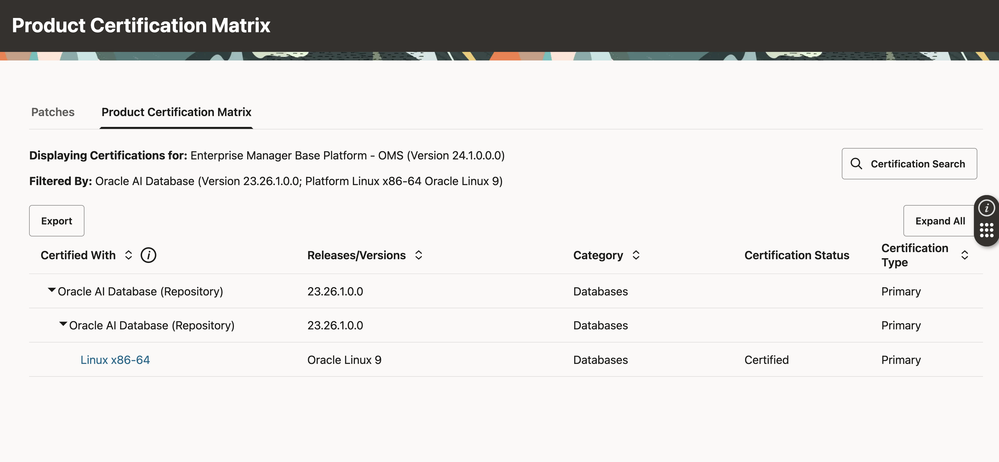
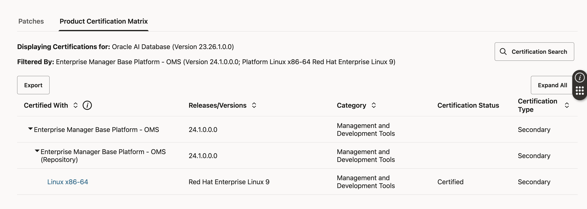
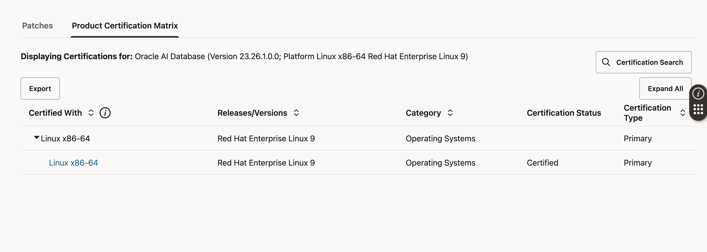
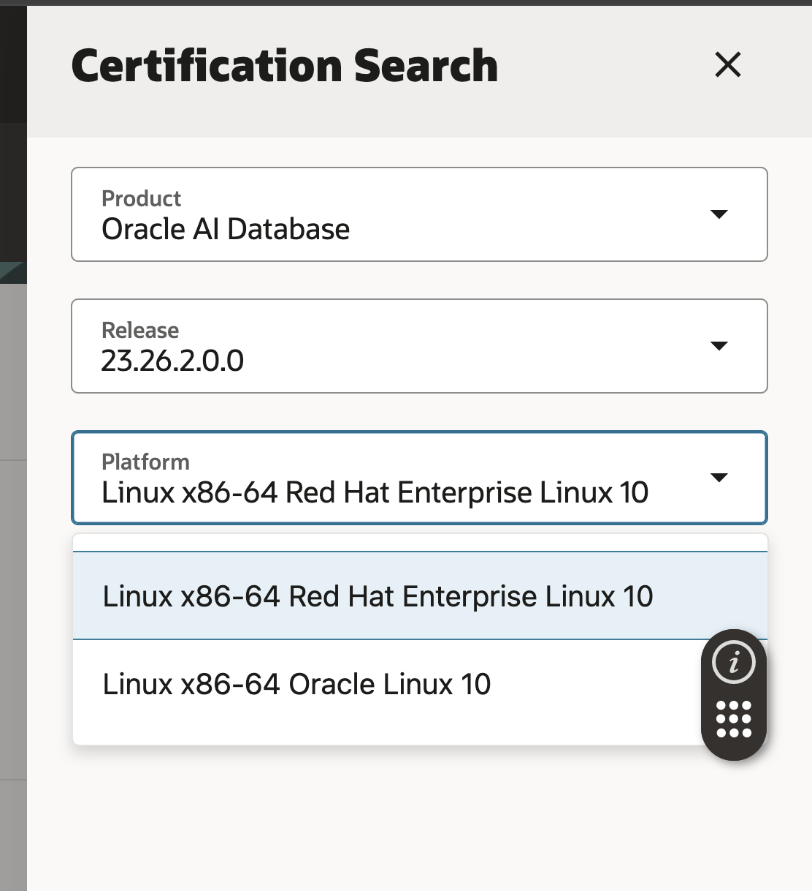
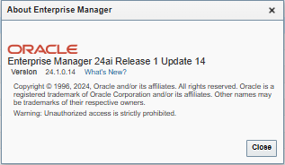

This started as a simple question. I wanted to move our OEM repository database from 19c to Oracle AI Database 26ai. Before touching anything, I checked whether my OMS was certified for it.

That check turned into two things I didn't plan for. First, the OMS turned out to be sitting on the **base 24ai release**, never patched since install. Fourteen RUs behind. Second, I nearly told my team that a 26ai repository wasn't supported, because the docs and blogs didn't mention it. The MOS certification matrix said otherwise.

So this post is the RU14 patching, end to end, with every bit of output. And a lesson about where certification answers actually live.

> **TL;DR**
> - OMS was on EM 24ai **24.1.0.0.0**. Patched to **24.1.0.14** (RU14, patch 39926529) in traditional single-OMS mode.
> - Console downtime: **~55 minutes**. Total apply run: ~91 minutes.
> - Gotchas: OMSPatcher reads `ORACLE_HOME` not your current directory, piping `omspatcher` through `tee` breaks its password prompt, and `sysman.mgmt_versions` does **not** show the RU level.
> - 26ai as the OMR **is certified** for EM 24ai (23.26.1, on OL9 and RHEL9). The docs just don't say so. MOS does. The repository upgrade is part 2.

---

## Table of Contents

- [The Environment](#the-environment)
- [Where I Started](#where-i-started)
  - [Is the agent alive?](#is-the-agent-alive)
  - [OMSPatcher error code 15](#omspatcher-error-code-15)
  - [What's actually installed](#whats-actually-installed)
- [The 26ai Detour: Silence Is Not "No"](#the-26ai-detour-silence-is-not-no)
- [The Patch Set](#the-patch-set)
- [Step 1: Update OPatch](#step-1-update-opatch)
- [Step 2: Update OMSPatcher](#step-2-update-omspatcher)
- [Step 3: Backups](#step-3-backups)
- [Step 4: WebLogic Property File](#step-4-weblogic-property-file)
- [Step 5: Analyze (and the `tee` Trap)](#step-5-analyze-and-the-tee-trap)
- [Step 6: Apply](#step-6-apply)
- [Step 7: Verify](#step-7-verify)
- [What's Left](#whats-left)
- [Lessons](#lessons)
- [References](#references)

---

## The Environment

| Component | Detail |
|---|---|
| OS | RHEL 9.8 |
| OMS | EM 24ai, single OMS, same host as the repository |
| Repository DB | 19c (19.31) CDB, EM schema in PDB `PDBEMDB` |
| Agent | 24.1.0.0.0 central agent |

```sql
SQL*Plus: Release 19.0.0.0.0 - Production on Thu Oct 22 16:26:32 2026
Version 19.31.0.0.0

Connected to:
Oracle Database 19c Enterprise Edition Release 19.0.0.0.0 - Production
Version 19.31.0.0.0

SQL> show pdbs;

    CON_ID CON_NAME                       OPEN MODE  RESTRICTED
---------- ------------------------------ ---------- ----------
         2 PDB$SEED                       READ ONLY  NO
         3 PDBEMDB                        READ WRITE NO
```

---

## Where I Started

### Is the agent alive?

```bash
SQL> !ps -ef|grep agent
```

```text
oracle      4453       1  0 Jun12 ?        00:07:32 /u01/app/oracle/agent/agent_24.1.0.0.0/perl/bin/perl /u01/app/oracle/agent/agent_24.1.0.0.0/bin/emwd.pl agent /u01/app/oracle/agent/agent_inst/sysman/log/emagent.nohup
oracle      7773    4453  0 Jun12 ?        18:45:07 /u01/app/oracle/agent/agent_24.1.0.0.0/oracle_common/jdk/bin/java -Xmx687M -XX:MaxMetasp
```

Watchdog plus JVM, both up since June. Fine. The path is the interesting bit: `agent_24.1.0.0.0`. So this is 24ai, not 13.5. That matters, because certification is per EM release.

### OMSPatcher error code 15

Next I wanted the OMS patch level.

```bash
╰──🚀 omspatcher lspatches
-bash: omspatcher: command not found
╰──🚀 ./omspatcher lspatches
OMSPatcher Automation Tool
Copyright (c) 2024, Oracle Corporation.  All rights reserved.

OMSPatcher : This omspatcher is not compatible with the current omshome /u01/app/oracle/product/19.0.0/dbhome_1 version

OMSPatcher failed with error code 15
```

Look at the "omshome" it complains about. That's my **database** home. I'd been in sqlplus a minute earlier and `ORACLE_HOME` still pointed at it.

OMSPatcher doesn't care which directory you're standing in. It reads `ORACLE_HOME`.

```bash
export ORACLE_HOME=/u01/app/oracle/middleware/oms_home
./omspatcher lspatches
```

> **Tip:** I hit this same trap three more times during the patching. New shell, profile resets `ORACLE_HOME` to the DB home, OMSPatcher sulks. My profile already had `$OMS_HOME` set, so `export ORACLE_HOME=$OMS_HOME` became the first line of every session.

### What's actually installed

```text
OMSPatcher version : 13.9.24.1.0
OUI version        : 13.9.4.0.0
Running from       : /u01/app/oracle/middleware/oms_home
```

<details>
<summary><b><code>omspatcher lspatches</code> output, trimmed (click to expand)</b></summary>

```text
Component Name/Version                            Component Type      System Patch        (Sub)-Patches       Patch Description
------------------------                          -------------       -------------       --------------      ------------------
oracle.org.springframework.spring.messag          Core                N/A                 37103277            FMW Thirdparty Bundle Patch 12.2.1.4.240925
ing.vrelease/5.1.3.0.0

oracle.datadirect/12.2.1.4.0                      Core                N/A                 37087476            WLS PATCH SET UPDATE 12.2.1.4.240922

oracle.network.listener/19.0.0.0.0                Core                N/A                 36615359            DATABASE RELEASE UPDATE 19.24.0.0.0 FOR FMW DBCLIENT

oracle.webcenter.wccore/12.2.1.4.0                Core                N/A                 36964687            WebCenter Core Bundle Patch 12.2.1.4.240819

oracle.opss.wls/12.2.1.4.0                        Core                N/A                 36316422            OPSS Bundle Patch 12.2.1.4.240220

oracle.fmw.upgrade.ohs/12.2.1.4.0                 Core                N/A                 37033394            OHS (NATIVE) DB19C BUNDLE PATCH 12.2.1.4.240906

oracle.pki/12.2.1.4.0                             Core                N/A                 37096063            OSS 19C BUNDLE PATCH 12.2.1.4.241001

oracle.jrf.adfrt/12.2.1.4.0                       Core                N/A                 37028738            ADF BUNDLE PATCH 12.2.1.4.240905
                                                                      N/A                 34809489            One-off

oracle.wsm.common/12.2.1.4.0                      Core                N/A                 37035947            OWSM BUNDLE PATCH 12.2.1.4.240908

oracle.coherence/12.2.1.4.0                       Core                N/A                 1221423             Coherence Cumulative Patch 12.2.1.4.23

oracle.fmwplatform.fmwprov/12.2.1.4.0             Core                N/A                 36789759            FMW PLATFORM BUNDLE PATCH 12.2.1.4.240812

oracle.sysman.rcu/12.2.1.4.0                      Core                N/A                 30152128            One-off

... (about 150 component rows in total, all against the same handful of patches)

NOTE: N/A indicates that the subpatch mentioned in the Subpatches column was applied as a one-off patch and not as part of any system patch.

OMSPatcher succeeded.
```

</details>

Every patch in the list is Fusion Middleware plumbing, dated mid to late 2024:

| Patch | Description |
|---|---|
| 37087476 | WLS PATCH SET UPDATE 12.2.1.4.240922 |
| 37103277 | FMW Thirdparty Bundle Patch 12.2.1.4.240925 |
| 37096063 | OSS 19C Bundle Patch 12.2.1.4.241001 |
| 37033394 | OHS (Native) DB19C Bundle Patch 12.2.1.4.240906 |
| 37028738 | ADF Bundle Patch 12.2.1.4.240905 |
| 37035947 | OWSM Bundle Patch 12.2.1.4.240908 |
| 36615359 | DB RU 19.24 for FMW DB client |
| 36316422 | OPSS Bundle Patch 12.2.1.4.240220 |

No "Platform Update" line anywhere. That's the EM RU. So: **base 24.1.0.0.0, never patched.**

The repository agreed on the release:

```sql
COMPONENT_NAME                   VERSION                              STATUS
-------------------------------- -------------------------------- ----------
AI                               24.1.1.0.0                                1
CFW                              24.1.1.0.0                                1
CORE                             24.1.0.0.0                                4
CORE_ZDT                         24.1.0.0.0                                1
DB                               24.1.1.0                                  1
...
22 rows selected.
```

Hold that thought about `CORE`. It comes back later.

---

## The 26ai Detour: Silence Is Not "No"

Here's the part I'm not proud of.

I went looking for "26ai as the EM 24ai repository". The upgrade guide lists 19.22 as the repository minimum. The RU1 to RU14 new-features list mentions 26ai only as a **managed target** (fleet maintenance, cloning in RU9). Oracle's own Marketplace image runs the OMR on 19c. An Oracle ACE blog said 24ai only supports 19c as the repository.

So I concluded: not supported. I even wrote it into the change ticket.

Then I checked the **MOS Product Certification Matrix**:


*Enterprise Manager Base Platform - OMS 24.1.0.0.0, filtered by Oracle AI Database 23.26.1.0.0. Repository on OL9: Certified.*

```text
Displaying Certifications for: Enterprise Manager Base Platform - OMS (Version 24.1.0.0.0)
Filtered By: Oracle AI Database (Version 23.26.1.0.0; Platform Linux x86-64 Oracle Linux 9)

Oracle AI Database (Repository)   23.26.1.0.0   Databases
  Linux x86-64   Oracle Linux 9   Databases   Certified   Primary
```

My host is RHEL, not OL. So I flipped the search around: start from the database and filter by EM on RHEL 9.


*Same relationship, viewed from the database side. "Secondary" just means you're looking at it from the DB's direction.*

```text
Displaying Certifications for: Oracle AI Database (Version 23.26.1.0.0)
Filtered By: Enterprise Manager Base Platform - OMS (Version 24.1.0.0.0; Platform Linux x86-64 Red Hat Enterprise Linux 9)

Enterprise Manager Base Platform - OMS (Repository)   24.1.0.0.0
  Linux x86-64   Red Hat Enterprise Linux 9   Management and Development Tools   Certified   Secondary
```

Plus the two OS rows. The OMS itself on RHEL 9:


*Category "Operating Systems". This is the OMS host, not the repository. Easy to misread.*

And 26ai 23.26.1 as a plain database on RHEL 9:


*The last layer. The database release itself is certified on my OS.*

Full picture:

| Layer | Status |
|---|---|
| 26ai (23.26.1) DB on RHEL 9 | Certified |
| OMS 24.1 on RHEL 9 | Certified |
| 26ai repository for EM 24.1 on OL9 | Certified |
| 26ai repository for EM 24.1 on RHEL 9 | Certified |

> **Warning:** Docs, release notes and blogs being silent about a combination is not the same as "unsupported". Every one of my sources was about something adjacent. The cert matrix is the only place that answers the question you actually asked. Check it first, not last.

One side trip worth mentioning: a search for Oracle AI Database **23.26.2** only listed Linux 10 platforms in the dropdown.


*For a minute I thought "repo only on Linux 10". Wrong question, wrong release.*
 Different question (where the DB itself installs, for that RU), but it's why I pinned the repository upgrade to **23.26.1**, the exact release in the EM certification.

Anyway. Repository upgrade is part 2. First, the OMS needed fourteen RUs.

---

## The Patch Set

RU14 had shipped two days earlier (20-Oct-2026). RUs are cumulative, so base straight to RU14 is fine.

| Patch | What | Platform |
|---|---|---|
| 39926529 | OMS RU14 (24.1.0.14) | Generic |
| 39926539 | Agent RU14 | Generic |
| 19999993 | OMSPatcher (latest) | Generic |
| 28186730 | OPatch 13.9.4.2.25 for EM 13.5/24.1 and FMW | Generic |

Single OMS means **no Zero Downtime patching**. ZDT needs two or more OMSs. Traditional `omspatcher apply`, console down.

Staged and checksummed against MOS:

```bash
╰──🚀 ls -ltr
-rwxrwxr-x.  1 oracle oinstall    61294397 Oct 23 10:34 p28186730_1394225_Generic.zip
-rwxrwxr-x.  1 oracle oinstall     3145610 Oct 23 10:34 p19999993_241000_Generic.zip
-rwxrwxr-x.  1 oracle oinstall  2203555805 Oct 23 10:35 p39926529_241000_Generic.zip
-rwxrwxr-x.  1 oracle oinstall   182840219 Oct 23 10:35 p39926539_241000_Generic.zip

e4798826ea8f28fe58aa1b441e480fe8a1e16e9f2d63cd80770c7fc72ca83eef  p28186730_1394225_Generic.zip
b86bc1613501fda04876c61502081933c59517d9badb53b22edc1ac638419945  p19999993_241000_Generic.zip
daf385c08223be8992d0f8476d8d7c9b390b510fbc4d188bb1a76e01b2d70962  p39926529_241000_Generic.zip
06c27d5aab876656e79d93610345c6454e3a5f5d02e7dceaf4d08cdab629f9de  p39926539_241000_Generic.zip
```

A 2.2 GB RU zip that got truncated would only blow up halfway through the apply. Two minutes of `sha256sum` is cheap.

Quick OS sanity check too, since this RHEL box gets regular updates:

```bash
╰──🚀 rpm -q binutils gcc glibc glibc-devel libaio libgcc libstdc++ make sysstat
binutils-2.35.2-72.el9.x86_64
gcc-11.5.0-14.el9.x86_64
glibc-2.34-275.el9_8.x86_64
glibc-devel-2.34-275.el9_8.x86_64
libaio-0.3.111-13.el9.x86_64
libgcc-11.5.0-14.el9.x86_64
libstdc++-11.5.0-14.el9.x86_64
make-4.3-8.el9.x86_64
sysstat-12.5.4-11.el9.x86_64
```

---

## Step 1: Update OPatch

```bash
$ORACLE_HOME/OPatch/opatch version
OPatch Version: 13.9.4.2.17
```

Too old. This OPatch line installs through its own Java installer, not by unzipping over the old directory:

```bash
cp -rp $ORACLE_HOME/OPatch $ORACLE_HOME/OPatch.bak_$(date +%Y%m%d)
cd /backup/software
unzip -q p28186730_1394225_Generic.zip
$ORACLE_HOME/oracle_common/jdk/bin/java -jar /backup/software/6880880/opatch_generic.jar -silent oracle_home=$ORACLE_HOME
```

```text
Saving the inventory oracle.jrf.wlst
 Component : fmwshare-wlst-dependencies
Saving the inventory fmwshare-wlst-dependencies
 Component : oracle.fmwshare.pyjar
Saving the inventory oracle.fmwshare.pyjar

The install operation completed successfully.

Logs successfully copied to /u01/app/oracle/oraInventory/logs.

╰──🚀 $ORACLE_HOME/OPatch/opatch version
OPatch Version: 13.9.4.2.25

OPatch succeeded.
```

---

## Step 2: Update OMSPatcher

This one is the old-fashioned way. Move aside, unzip into the OMS home:

```bash
╰──🚀 mv OMSPatcher OMSPatcher.bak_$(date +%Y%m%d)
╰──🚀 unzip -q /backup/software/p19999993_241000_Generic.zip -d $ORACLE_HOME
╰──🚀 $ORACLE_HOME/OMSPatcher/omspatcher version
OMSPatcher Version: 13.9.24.18.0
OPlan Version: 12.2.0.1.16
OsysModel build: Tue Apr 28 18:16:31 PDT 2020

OMSPatcher succeeded.
```

13.9.24.1.0 to 13.9.24.18.0. The analyze log later confirmed `min_patching_tool_version check` passed.

---

## Step 3: Backups

Three layers.

**OMS config export:**

```text
╰──🚀 $ORACLE_HOME/bin/emctl exportconfig oms -dir /backup/software/oms_export_$(date +%Y%m%d)
Enter Enterprise Manager Root (SYSMAN) Password :
ExportConfig started...
Machine is Admin Server host. Performing Admin Server backup...
Exporting emoms properties...
Exporting secure properties...

Export has determined that the OMS is not fronted
by an SLB. The local hostname was NOT exported.
...
Backup has been written to file: /backup/software/oms_export_20261023/opf_ADMIN_20261023_105029.bka

The export file contains sensitive data.
 You must keep it secure.

ExportConfig completed successfully!
```

The SLB message is informational for a single OMS. `chmod 600` the `.bka`. It has secrets in it.

**Guaranteed restore point on the repository.** Flashback was off, but you don't need it on for a GRP. ARCHIVELOG plus an FRA is enough:

```sql
SQL> select log_mode, flashback_on from v$database;
LOG_MODE     FLASHBACK_ON
------------ ------------------
ARCHIVELOG   NO

SQL> show parameter db_recovery_file_dest
db_recovery_file_dest                string      /oradata/FRA
db_recovery_file_dest_size           big integer 50G

SQL> select space_limit/1024/1024/1024 limit_gb, space_used/1024/1024/1024 used_gb,
       space_reclaimable/1024/1024/1024 reclaimable_gb from v$recovery_file_dest;
  LIMIT_GB    USED_GB RECLAIMABLE_GB
---------- ---------- --------------
        50 39.9574285     39.9574285
```

40 GB "used" but all reclaimable. Checked the filesystem under it actually had the space (79 GB free), then:

```sql
SQL> create restore point before_em_ru14 guarantee flashback database;
Restore point created.

NAME              GUA TIME
BEFORE_EM_RU14    YES 23-OCT-26 10.53.04.000000000 AM
```

> **Warning:** A GRP pins flashback logs and archivelogs until you drop it. Fill the FRA and the repository stops, which takes the OMS with it. Put the drop on your calendar.

**OMS home tar:**

```bash
╰──🚀 tar -czf /backup/software/oms_home_pre_ru14_$(date +%Y%m%d).tgz -C /u01/app/oracle/middleware oms_home
╰──🚀 ls -lh /backup/software/oms_home_pre_ru14_*.tgz
-rw-r--r--. 1 oracle oinstall 11G Oct 23 11:03 /backup/software/oms_home_pre_ru14_20261023.tgz
```

Ten minutes, 11 GB. Cheap insurance.

---

## Step 4: WebLogic Property File

OMSPatcher has to log in to the WebLogic Admin Server to redeploy EM apps. A property file saves you from prompts.

```bash
╰──🚀 $ORACLE_HOME/bin/emctl status oms -details | grep -i -A1 "admin server"
Admin Server Host      : omshost.example.com
Admin Server HTTPS Port: 7102
Admin Server is RUNNING
```

```text
╰──🚀 $ORACLE_HOME/OMSPatcher/wlskeys/createkeys.sh -oh $ORACLE_HOME -location /backup/software/wlskeys
The oraclehome passed is valid.
The wls url is t3s://omshost.example.com:7102

Please enter weblogic admin server username : weblogic
Please enter weblogic admin server password :
...
Successfully connected to Admin Server "EMGC_ADMINSERVER" that belongs to domain "GCDomain".
...
User configuration file created: /backup/software/wlskeys/config
User key file created: /backup/software/wlskeys/key
'createkeys' succeeded.
```

```properties
AdminServerURL=t3s://omshost.example.com:7102
AdminConfigFile=/backup/software/wlskeys/config
AdminKeyFile=/backup/software/wlskeys/key
```

`chmod 600` on both the property file and the keys.

---

## Step 5: Analyze (and the `tee` Trap)

I wanted a copy of the analyze output, so I piped it through `tee`. Seemed sensible.

```bash
$ORACLE_HOME/OMSPatcher/omspatcher apply -analyze \
  -property_file /backup/software/omspatcher.properties \
  2>&1 | tee /backup/software/ru14_analyze_$(date +%Y%m%d_%H%M).log
```

```text
Log file location: /u01/app/oracle/middleware/oms_home/cfgtoollogs/omspatcher/39926529/omspatcher_2026-10-23_11-21-28AM_analyze.log

Recommended actions: Please verify the error details and try again.

OMSPatcher failed with error code 231
```

Five seconds. The analyze log said almost nothing. The real error was in the opatch log:

```text
[Oct 23, 2026 11:21:33 AM]   Stack Description: java.lang.NullPointerException
[Oct 23, 2026 11:21:33 AM]   StackTrace: oracle.opatchauto.oms.OMSSessionHelper.getDbUser(OMSSessionHelper.java:1942)
[Oct 23, 2026 11:21:33 AM]   StackTrace: oracle.opatchauto.oms.OMSApplySession.process(OMSApplySession.java:522)
[Oct 23, 2026 11:21:33 AM]   [ Error during Prereq validations phase ] Detail:                              OMSPatcher is not able to get the required inputs.
OUI-67073:OMSPatcher failed: null
```

`getDbUser` is where OMSPatcher prompts for the repository DB user. It reads through Java's console. **Java has no console when stdout is piped.** No prompt, null input, crash.

The `SEVERE: Bundle.xml was not found at the given patch location .../39669543/bundle.xml` lines above it are noise, by the way. OMSPatcher tries each sub-patch against several validators and some say "not mine".

> **Tip:** Never pipe `omspatcher` through `tee`. Use `script` instead. It gives the process a real terminal and records everything:
> ```bash
> script -a /backup/software/ru14_analyze_$(date +%Y%m%d_%H%M).log
> export ORACLE_HOME=$OMS_HOME     # script starts a new shell
> $ORACLE_HOME/OMSPatcher/omspatcher apply -analyze -property_file /backup/software/omspatcher.properties
> exit
> ```

Second attempt, with a real terminal:

```text
OMSPatcher version : 13.9.24.18.0
OUI version        : 13.9.4.0.0
Running from       : /u01/app/oracle/middleware/oms_home

Enter SYS or Non-SYS (Admin User) username: sys
Enter 'sys' password :
Remove invalid objects from DB before you proceed. Check invalid objects in DB : Failed

Please refer omspatcher log for invalid objects details

Prereq "checkComponents" for patch 39911895 passed.
...
Configuration Validation: Success
...
OMSPatcher succeeded.
```

Analyze passed, but flagged invalid objects in the repository:

```text
[Oct 23, 2026 11:26:19 AM]   Invalid objects are found in the repository.
[Oct 23, 2026 11:26:19 AM]   OBJECT_NAME, OBJECT_TYPE, OWNER
[Oct 23, 2026 11:26:19 AM]   GENSVC_AVAIL_DOCTOR,PACKAGE BODY,SYSMAN
[Oct 23, 2026 11:26:19 AM]   EM_SLM_DOCTOR,PACKAGE BODY,SYSMAN
[Oct 23, 2026 11:26:19 AM]   REP_METRIC_DOCTOR,PACKAGE BODY,SYSMAN
[Oct 23, 2026 11:26:19 AM]   POST_UGC,PACKAGE BODY,SYSMAN
[Oct 23, 2026 11:26:19 AM]   EM_ASSETSPOS_MGMT,PACKAGE BODY,SYSMAN
[Oct 23, 2026 11:26:19 AM]   DM_FMTLIB,PACKAGE BODY,SYSMAN
[Oct 23, 2026 11:26:19 AM]   MGMT$MASK_UTIL,PACKAGE BODY,SYSMAN
```

Seven SYSMAN package bodies. Probably left over from the 19.31 DB RU back in June. They recompiled clean:

```sql
SQL> alter session set container=PDBEMDB;
SQL> alter package sysman.GENSVC_AVAIL_DOCTOR compile body;
...
SQL> alter package sysman."MGMT$MASK_UTIL"    compile body;   -- quotes because of the $
Package body altered.   (x7)

SQL> select owner, object_type, object_name from dba_objects where status='INVALID' order by 1,2,3;
no rows selected
```

(Remember `DM_FMTLIB`. It's going to be a whole subplot in part 2.)

Analyze again. Clean:

```text
Prereq "checkComponents" for patch 39911895 passed.
Prereq "checkComponents" for patch 39911940 passed.
Prereq "checkComponents" for patch 39911901 passed.
Prereq "checkComponents" for patch 39911924 passed.
Prereq "checkComponents" for patch 39911898 passed.
Prereq "checkComponents" for patch 39911932 passed.
Prereq "checkComponents" for patch 39911952 passed.

Configuration Validation: Success

Running apply prerequisite checks for sub-patch(es) "39911895,39911940,39911901,39911924,39911898,39911932" and Oracle Home "/u01/app/oracle/middleware/oms_home"...
Sub-patch(es) "39911895,39911940,39911901,39911924,39911898,39911932" are successfully analyzed for Oracle Home "/u01/app/oracle/middleware/oms_home"

Running apply prerequisite checks for sub-patch(es) "39911952" and Oracle Home "/u01/app/oracle/middleware/ext_oms_home"...
Sub-patch(es) "39911952" are successfully analyzed for Oracle Home "/u01/app/oracle/middleware/ext_oms_home"

Prerequisites analysis summary:
-------------------------------

The following sub-patch(es) are applicable:

             Featureset                                             Sub-patches
             ----------                                             -----------
  oracle.sysman.top.oms   39911895,39911940,39911901,39911924,39911898,39911932
  oracle.sysman.top.zdt                                                39911952

The following sub-patches are not needed by any component installed in the OMS system:
39911912,39911928,39911907,39911944,39669543,39808008

OMSPatcher succeeded.
```

Analyze alone took about 9 minutes. Six "not needed" sub-patches are for components I don't have. Normal.

---

## Step 6: Apply

> **Note:** Don't stop the OMS yourself. OMSPatcher needs the Admin Server up to connect via the property file, and it stops and starts the OMS and central agent on its own.

Inside `script` and `tmux`:

```bash
export ORACLE_HOME=$OMS_HOME
date
$ORACLE_HOME/OMSPatcher/omspatcher apply -property_file /backup/software/omspatcher.properties
```

```text
Fri Oct 23 11:53:56 AM EDT 2026
OMSPatcher Automation Tool
...
Enter SYS or Non-SYS (Admin User) username: sys
Enter 'sys' password :

Configuration Validation: Success
...
To continue, OMSPatcher will do the following:
[Patch and deploy artifacts]   : Apply sub-patch(es) [ 39911895 39911898 39911901 39911924 39911932 39911940 39911952 ]
                                 Apply RCU artifact with patch ".../39911895_Oct_13_2026_00_40_02/original_patch";
                                 ...
                                 Register MRS artifact "commands";
                                 Register MRS artifact "metricAdapter";
                                 ...
                                 Register MRS artifact "derivedAssocs"

Do you want to proceed? [y|n]
y
User Responded with: Y
Stopping all the services on primary OMS.....
Stopping the agent ......
Applying the one-off patch  .....

Applying sub-patch(es) "39911895,39911898,39911901,39911924,39911932,39911940"
Applying sub-patch(es) "39911952"
Starting the ADMIN .....
Undeploying Library  .....log4j-api_jar#2.22@2.22.1
...
Deploying Library  .....log4j-core_jar#2.26@2.26.1
Deploying Library  .....org.bouncycastle.bcprovider#1.1@1.83.0
...
Configure API Gateway  .....
Sync the Config in Wars  .....
Registering the start OP ......
DB user 'sys' is allowed to perform startOP patching operation.

Updating repository with RCU reference file ".../39911895_Oct_13_2026_00_40_02/original_patch"
...
Registering service "commands" with register file ".../commands.xml" for plugin id as "core"...
...
Registering service "derivedAssocs" with register file ".../oracle_cloud_vm_cluster_assoc_rules.xml" for plugin id as "oracle.sysman.xa"...

Running the post MRS sql .....
Starting the agent ......
Resetting the patching flag .....
Resetting the job queue process .....

The job_queue_processes parameter is set to 0 in the repository database. Resetting the job_queue_processes parameter to its original value 80 in the repository database to start the OMS.
Registering the end OP ......
Running the post apply sql .....
Starting the oms

Complete Summary
================

Patching summary:
-----------------

Binaries of the following sub-patch(es) have been applied successfully:

                        Featureset                                             Sub-patches
                        ----------                                             -----------
  oracle.sysman.top.zdt_24.1.0.0.0                                                39911952
  oracle.sysman.top.oms_24.1.0.0.0   39911895,39911898,39911901,39911924,39911932,39911940

The following sub-patches are not needed by any component installed in the OMS system:
39911912,39911928,39911907,39911944,39669543,39808008

Deployment summary:
-------------------

The following artifact(s) have been successfully deployed:
                              SQL                rcu_applypatch_original_patch_2026-10-23_12-44-10PM.log
                              ...  (7 SQL artifacts, ~70 MRS registrations)

OMSPatcher succeeded.
```

Look at those library swaps: log4j 2.22 to 2.26, bouncycastle 1.83. That's the security debt a base-release OMS carries around.

Where the time went:

| Event | Time |
|---|---|
| `apply` started | 11:53:56 |
| Prereqs done, `y`, **OMS stopped** | 12:26:48 |
| Agent stopped | 12:27:30 |
| Binaries (oms_home, then ext_oms_home) | 12:32 to 12:36 |
| Admin Server up, library redeploy | 12:36 to 12:44 |
| Repository SQL (RCU) | 12:44 to 12:49 |
| MRS metadata registration | 12:49 to 13:18 |
| Agent started | 13:19:05 |
| **OMS started** | 13:20:36 |
| `OMSPatcher succeeded` | 13:25:01 |

**Console down ~55 minutes.** MRS registration was the long pole at about half an hour. The Exadata (`xa`) plugin's target type and default collection registrations took minutes each. If you have fewer plugins, expect faster.

---

## Step 7: Verify

```text
╰──🚀 $ORACLE_HOME/OMSPatcher/omspatcher lspatches | grep -i "Platform Update"
oracle.sysman.top.oms/24.1.0.0.0  Core  39926529  39911895  Oracle Enterprise Manager 24ai Release 1 Platform Update 14 (24.1.0.14) for Oracle Management Service

╰──🚀 $ORACLE_HOME/bin/emctl status oms
WebTier is Up
Oracle Management Server is Up
JVMD Engine is Up

╰──🚀 /u01/app/oracle/agent/agent_inst/bin/emctl status agent | grep -iE "agent version|last successful|status"
Agent Version          : 24.1.0.0.0
Last successful upload                       : 2026-10-23 14:36:28
Collection Status                            : Collections enabled
Heartbeat Status                             : Ok
Last successful heartbeat to OMS             : 2026-10-23 14:38:42
```

And the repository side:

```sql
SQL> select component_name, version from sysman.mgmt_versions where component_name like 'CORE%' order by 1;

COMPONENT_NAME                   VERSION
-------------------------------- --------------------------------
CORE                             24.1.0.0.0
CORE_METADATA                    24.1.0.0.0
CORE_PREMDS                      24.1.0.0.0
CORE_ZDT                         24.1.0.0.0

SQL> select count(*) from dba_objects where owner='SYSMAN' and status='INVALID';
  COUNT(*)
         0

SQL> show parameter job_queue_processes
job_queue_processes                  integer     80
```

Remember that thought I asked you to hold?

> **Gotcha:** `sysman.mgmt_versions` **does not move when you apply an RU.** After RU14, `CORE` still says `24.1.0.0.0`. It tracks the release, not the RU. I'd assumed otherwise. The only reliable RU check is `omspatcher lspatches | grep -i "Platform Update"`, or Help, About in the console.


*Help, About Enterprise Manager. The cleanest "after" screenshot there is.*

---

## What's Left

| Item | Status |
|---|---|
| OMS RU14 (39926529) | Done |
| Agent RU14 (39926539) | Next, central agent first |
| October holistic patch (WLS/FMW CPU) | After the agent. RU first, holistic second, it checks a minimum RU |
| Drop GRP `BEFORE_EM_RU14` | Done a week later, once EM had been stable |
| Repository 19c to 26ai | Part 2 |

---

## Lessons

1. **Check the cert matrix before you check anything else.** I burned an evening proving a negative from sources that never addressed the question.
2. **OMSPatcher reads `ORACLE_HOME`, not your working directory.** Every new shell, set it again.
3. **Don't pipe `omspatcher` through `tee`.** It kills the password prompt. Use `script`.
4. **Fix invalid SYSMAN objects before you analyze.** It's a prereq check, and they're usually just a recompile away.
5. **`mgmt_versions` lies by omission.** It shows the release, not the RU.
6. **A base-release OMS is a security problem, not just a features problem.** The log4j and bouncycastle swaps in the apply output say it all.

---

## References

- [MOSC: EM 24ai RU14 & CPU now available](https://community.oracle.com/mosc/discussion/4601648/enterprise-manager-24ai-release-1-update-14-ru-14-cpu-is-now-available)
- [EM 24ai: New Features by Release Update](https://docs.oracle.com/en/enterprise-manager/cloud-control/enterprise-manager-cloud-control/24.1/emcon/new-features-release.html)
- [EM 24ai Upgrade Guide (PDF)](https://docs.oracle.com/en/enterprise-manager/cloud-control/enterprise-manager-cloud-control/24.1/emupg/enterprise-manager-upgrade-guide.pdf)
- [EM 24ai: Patching OMS and the Repository](https://docs.oracle.com/en/enterprise-manager/cloud-control/enterprise-manager-cloud-control/24.1/emadm/patching-oracle-management-service-repository.html)
- [EM 24ai: Certification Information](https://docs.oracle.com/en/enterprise-manager/cloud-control/enterprise-manager-cloud-control/24.1/emcon/enterprise-manager-certification-information.html)
- [Oracle blog: Zero Downtime Patching with EM 24ai](https://blogs.oracle.com/observability/introducing-zero-downtime-patching-with-enterprise-manager-24ai)
- [Martin Berger: EM 24ai patching (RU10 + holistic)](http://www.martinberger.swiss/posts/2026/2026-06-21-oracle-enterprise-manager-24ai-release-cspu-june-2026/)
- [dbainsight: EM 24ai August 2026 holistic patch](https://dbainsight.com/2026/09/oem-24ai-august-2026-holistic-39881086/)
